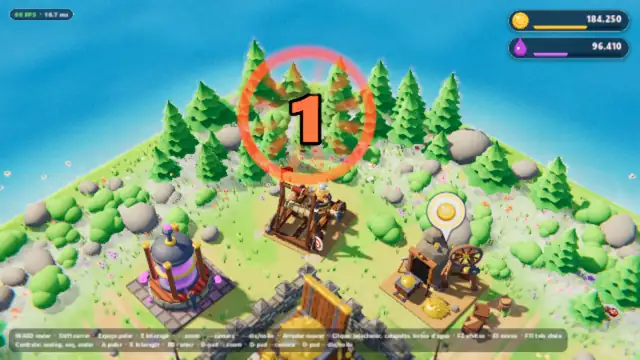
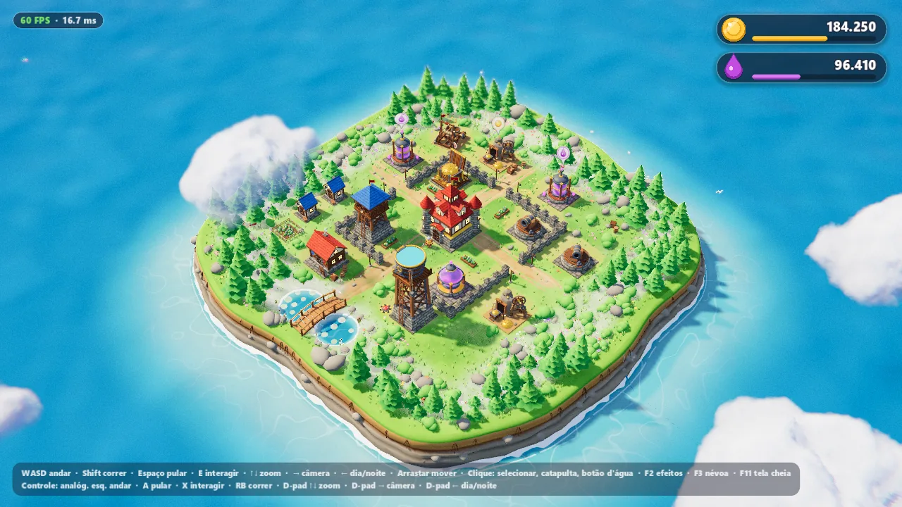
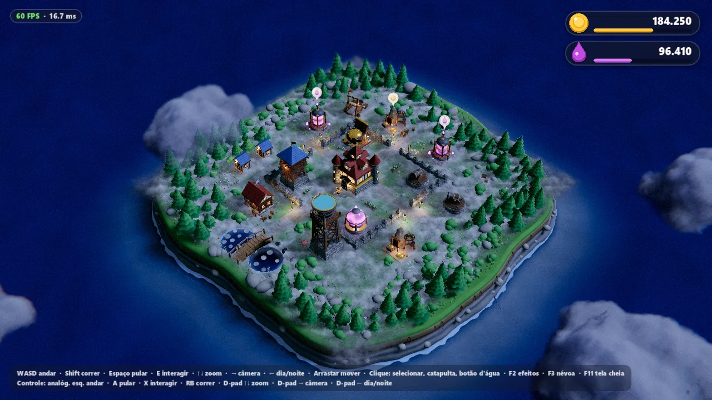
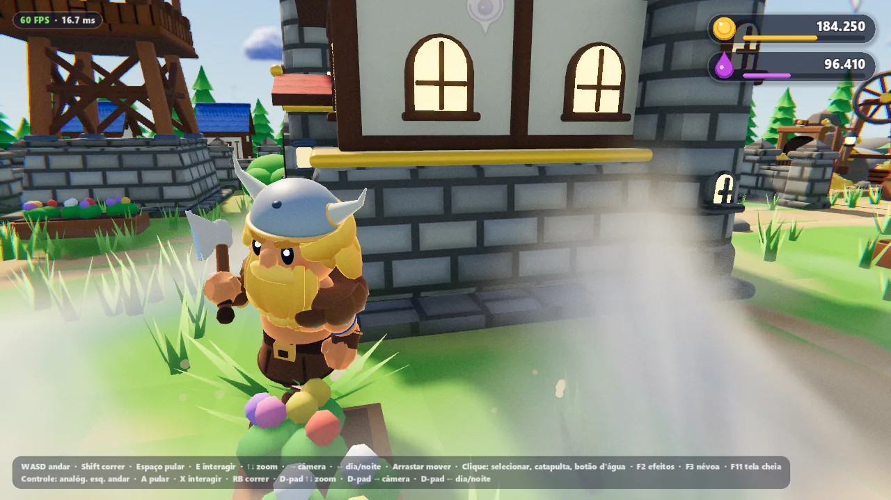
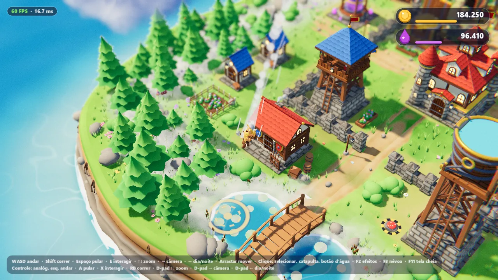
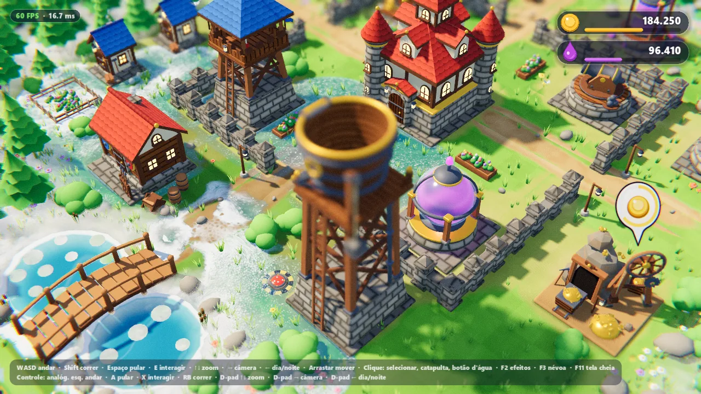
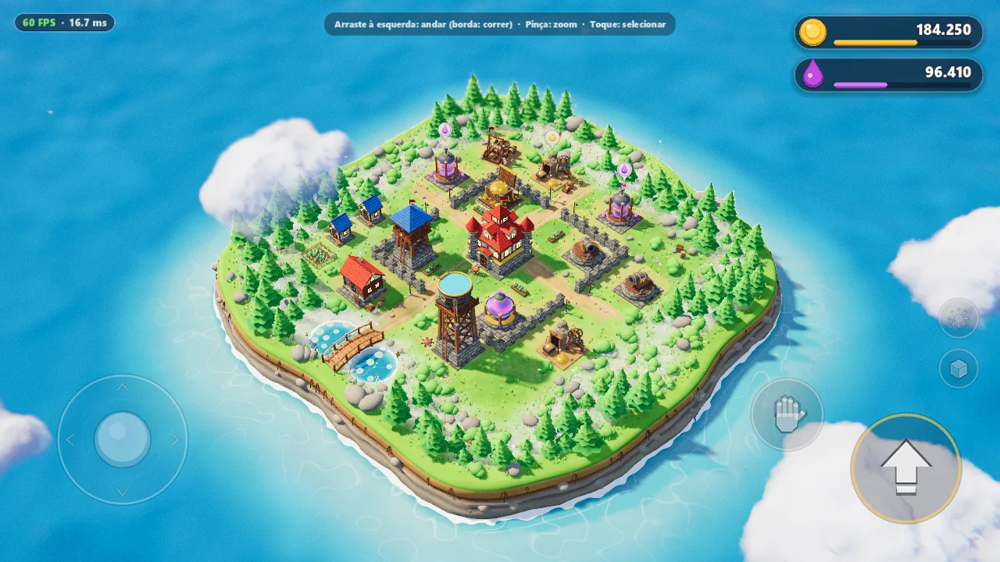

# Isometrico 3D

> A small isometric 3D island made with Godot 4.7: walk a viking through a village built from code, ride a catapult into a pond, flood the island with water and switch between day and night.



## What the game is

Isometrico 3D is a sandbox diorama, not a full game with goals. You control a small viking on a floating island with a village, a forest, a pond and a bridge.

- Walk, run and jump around the village.
- Collect gold and mana from the mines and collectors.
- Mount the catapult and fly into the pond.
- Press the water tower button and watch the water flood the island.
- Switch between day and night, and between the isometric camera and the over-the-shoulder camera.

All models are built from code at runtime: the island, the buildings, the trees, the character and the clouds. The repository has no imported 3D models or textures. All sound effects are also synthesized at runtime.

The in-game text is in Brazilian Portuguese.

## Gallery



| | |
| --- | --- |
|  |  |
| Night: lit windows, lamps, moon light and ground fog. | Over-the-shoulder camera. |
|  |  |
| Catapult ride: the landing ring on the pond. | The water tower floods the village. |
|  | |
| Touch controls (Android). | |

## Features

### World

- Island with a rounded outline, cliffs, a sea and a pond, all generated by code.
- Forest, bushes and rocks placed with `MultiMeshInstance3D`, with wind sway in the shader.
- Village props: barrels, crates, lantern posts, flower beds and fences.
- Ambient life: butterflies, falling leaves and gulls.
- Raymarched volumetric clouds that drift around the island and cast shadows on the ground.
- Ground fog from a GPU fluid simulation. The player pushes the fog when walking, running and landing.

### Buildings

- 12 building kinds plus walls: Town Hall, Gold Mine, Mana Collector, Gold Storage, Mana Storage, Cannon, Archer Tower, Barracks, Builder Hut, Water Tower, Water Button and Catapult.
- Each building is assembled from a kit of procedural shapes (beveled boxes, roofs, domes, arches) with custom shaders for stone, wood, roof tiles, glass and flags.
- Idle animations: spinning parts, bobbing parts, smoke, bubbles and flags.
- Static parts are merged into few meshes to keep the draw calls low.
- Click a building to select it and show its name.

### Player

- Procedural viking character with walk, run, jump, skid, squash and stretch, and hair springs.
- The player bumps into trees, buildings and props, and they wobble or shake.
- Footstep sounds change with the surface: grass, dirt and wood.
- The player can land in the pond, swim and climb back to the shore.

### Gameplay

- The Gold Mine and the Mana Collector fill over time. Click them or walk near them to collect. The HUD counts the totals.
- The catapult has a countdown, a launch, a flight with camera follow and a landing in the pond.
- The water tower button starts a pour sequence. A GPU shallow-water simulation spreads the water over the terrain, makes the ground wet and makes waterfalls at the cliff edges.

### Day and night

- One key or button blends between day and night.
- A moon light replaces the sun. Windows and lamps turn on with a flicker.
- The sky, the water, the grass, the fog and the clouds change with the night.

### Camera

- Isometric diorama camera: drag to pan with inertia, zoom toward the cursor, follow the player when the player moves.
- Over-the-shoulder camera with orbit, zoom and a shoulder swap.
- Camera shake, depth of field and a post pass with chromatic aberration and grain.

### Platforms and input

- Keyboard and mouse, gamepad and touch.
- Gamepad rumble. On Android, the phone also vibrates.
- A mobile quality tier for Android: smaller shadows, lower 3D resolution, cheaper clouds and fog.
- An in-game performance panel (see [Performance panel](#performance-panel)).

## Controls

| Action | Keyboard and mouse | Gamepad | Touch |
| --- | --- | --- | --- |
| Walk | `W` `A` `S` `D` | Left stick | Drag on the left side of the screen (virtual stick) |
| Run | Hold `Shift` | Hold `RB` | Push the virtual stick to its edge |
| Jump | `Space` | `A` (bottom button) | Jump button |
| Interact (mount the catapult when near) | `E` | `X` (left button) | Interact button |
| Select a building, collect, mount the catapult, press the water button | Left click | | Tap |
| Pan the camera (isometric mode) | Drag with the left or middle mouse button | | |
| Zoom | Mouse wheel, or hold `Up` / `Down` | D-pad up / down, or right stick up / down (isometric mode) | Pinch |
| Orbit the camera (shoulder mode) | Drag with the mouse | Right stick | Drag on the right side of the screen |
| Switch camera (isometric / shoulder) | `Right` arrow | D-pad right | Camera button |
| Swap the shoulder (shoulder mode) | `Tab` | Press the right stick | Swap button |
| Day / night | `Left` arrow | D-pad left | Sun / moon button |
| Post effects and depth of field on / off | `F2` | | |
| Fog debug view | `F3` | | |
| Fullscreen on / off | `F11` or `Alt` + `Enter` | | |
| Quit (Android) | | | Press back two times |

The touch controls show when the device has a touchscreen. They hide when you use a keyboard or a gamepad.

## Download

Get the builds from the [v1.0 release](https://github.com/salvimateus/isometrico-3d/releases/tag/v1.0).

- Windows: `isometrico-3d.exe`. The file has no code signature, so Windows SmartScreen can show a warning. Select "More info" and then "Run anyway" to start it.
- Android: `isometrico-3d.apk`. Give your browser or file manager the permission to install apps from unknown sources, then open the file.

The Windows build starts in fullscreen. Press `F11` to go to a window.

## Run from source

1. Install [Godot 4.7](https://godotengine.org/download) (standard version, not .NET).
2. Clone the repository:

   ```bash
   git clone https://github.com/salvimateus/isometrico-3d.git
   ```

3. Open `project.godot` in Godot.
4. Press `F5` to run the main scene, `scenes/main.tscn`.

The project uses the Forward+ renderer on desktop and the Mobile renderer on Android. The fog and the water use compute shaders.

## Export

`export_presets.cfg` has two presets. Both write to the `_build/` folder, which git ignores.

- `Windows Desktop`: writes `_build/SupercellTheGame.exe` with the game data embedded in the exe.
- `Android`: writes `_build/SupercellTheGame.apk` for `arm64-v8a` only, with no Gradle build.

Install the Godot 4.7.2 export templates first (Editor > Manage Export Templates).

The `Windows Desktop` preset points to a custom release template on the machine of the author. To use the standard template, clear that field:

1. Open Project > Export.
2. Select the `Windows Desktop` preset.
3. In the Options tab, find Custom Template > Release.
4. Clear the field.

You can also set `custom_template/release=""` in `export_presets.cfg`.

The `Android` preset has no keystore. Before you export, set the debug keystore in Editor Settings > Export > Android, or set a release keystore in the preset.

## Project structure

- `scenes/`: `main.tscn`, the game scene, and `scenes/dev/`, test scenes for single systems (buildings, catapult, character, clouds, fog, water).
- `scripts/`: all game code in GDScript, one folder per system (`world`, `buildings`, `character`, `camera`, `catapult`, `clouds`, `fog`, `liquid`, `audio`, `input`, `ui`). Each `dev/` folder holds sandboxes and probes.
- `shaders/`: the spatial shaders for each system, and the compute shaders for the fog and water simulations.
- `docs/screenshots/`: the images of this README. A `.gdignore` file keeps Godot from importing them.
- `PRIMITIVES.md`: the inventory of the shared contracts between the systems. Read it first to learn how the code fits together.

## Performance panel

Click or tap the FPS counter at the top left to open the performance panel.

- It shows the device and GPU names, the CPU and GPU frame times, the draw calls, the triangles and the 3D resolution scale.
- It has toggles for post effects, depth of field, glow, shadow size, MSAA, 3D scale (automatic or fixed), fog, clouds, night lights, the water simulation, foliage density and the FPS limit.
- The game saves your choices in `user://perf.cfg`.

## Test arguments

The game reads user arguments after `--`. They are for development and screenshots. For example:

```bash
godot --path . --resolution 1280x720 --fixed-fps 60 -- --shot=/absolute/path/shot.png --frames=240 --night=1
```

- `--shot=<absolute .png path>`: save a screenshot and quit. The run stays in a window and ignores the saved performance settings.
- `--frames=<N>`: the number of frames before the screenshot (default 120).
- `--night=1`: start at night.
- `--view=<name>`: start the camera on `overview`, `close`, `pond`, `ditch` or a building kind, for example `town_hall`. Add `--select=1` to select that building and `--distance=<N>` to set the camera distance.
- `--cam=follow`: start in the over-the-shoulder camera.
- `--player-demo`: the player walks, runs and jumps by itself. `--player-demo-mode=cycle|walk|run|jump|skid|idle` keeps one behavior.
- `--catapult-auto=<frame>`: put the player at the catapult and mount it at that frame.
- `--liquid-trigger=<frame>`: start the water tower pour at that frame.
- `--toggle-night-at=<frame>`: switch day and night at that frame.
- `--perf-panel=1`: open the performance panel.
- `--touch-ui=1`: show the touch controls on desktop.
- `--quality=mobile` or `--quality=high`: force a quality tier.
- `--postfx=0`: turn off the post pass and depth of field.
- `--no-fog=1`, `--no-clouds=1`, `--no-liquid=1`: turn off one system.

## Status

This is a personal study project. It is not maintained, and issues and pull requests will not get a reply.

## Disclaimer

This project is not affiliated with, endorsed by or connected to Supercell Oy. The internal app name mentions Supercell only as a study reference. All trademarks belong to their owners.

## License

This project is under the MIT License. See [LICENSE](LICENSE).
